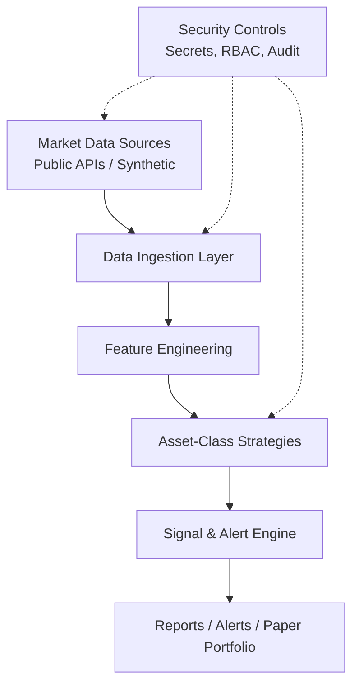

# Automated Cryptocurrency Trading Information System

> **Disclaimer:** This is an educational and informational system only. It generates signals, alerts, and analysis for paper trading or research. It does **not** execute real trades with live funds by default. Cryptocurrency trading involves substantial risk of loss. This is **not financial advice**. Past performance is not indicative of future results. Always do your own research and consult licensed professionals.

An automated information system for cryptocurrency markets that:
- Ingests market data (public APIs or synthetic fixtures)
- Generates trading signals and risk alerts tailored by **asset class**
- Provides a robust **cyber and data security architecture**
- Incorporates an AI-agent development harness inspired by secure practices (see reference: [zeekiankok92/aixtech-agent-harness-demo](https://github.com/zeekiankok92/aixtech-agent-harness-demo))

## Key Features

- **Multi-asset-class strategies**: Bitcoin, Ethereum, Major Altcoins, Stablecoins, DeFi tokens
- **Signal generation** (trend, momentum, mean-reversion, peg monitoring, on-chain proxies)
- **Risk management layers**: Position sizing guidance, volatility filters, drawdown alerts
- **Security-first design**: Secrets management, least-privilege API keys, audit trails, no withdrawal permissions
- **Extensible architecture** for paper trading, backtesting hooks, and future live integration (with extreme caution)

## Architecture Overview

See [docs/security-architecture.md](docs/security-architecture.md) and [docs/trading-strategies.md](docs/trading-strategies.md).



## Quick Start (Paper / Offline)

```bash
python3 -m venv .venv && source .venv/bin/activate
pip install -r requirements.txt
python -m crypto_info.demo
```

## Asset Classes Covered

| Asset Class | Primary Strategies | Risk Profile |
|-------------|--------------------|--------------|
| Bitcoin (BTC) | Trend following, DCA signals, Volatility regime | Medium-High |
| Ethereum (ETH) | ETH/BTC ratio, Gas/activity proxies, Smart-money flow | Medium-High |
| Major Altcoins | Momentum breakouts, Relative strength | High |
| Stablecoins | Peg deviation alerts, Yield opportunity signals | Low-Medium |
| DeFi Tokens | TVL change, Protocol health proxies | High |

## Security Highlights

- Environment variables / secrets manager only (never hardcode keys)
- API keys restricted to **trade-only or read-only** (never withdrawals)
- Recommended: dedicated sub-accounts, IP allow-lists, key rotation
- Audit logging of all signals and decisions
- Zero-trust principles applied to internal components

## Development

Follow [AGENTS.md](AGENTS.md) for AI coding agents. Run local checks before PRs.

## License

MIT
